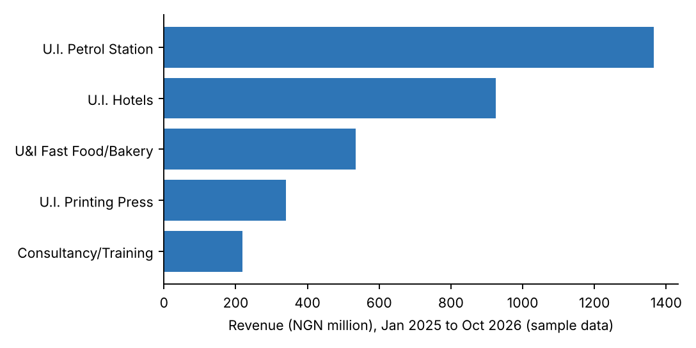
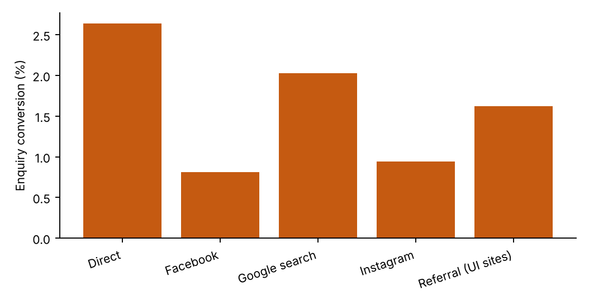
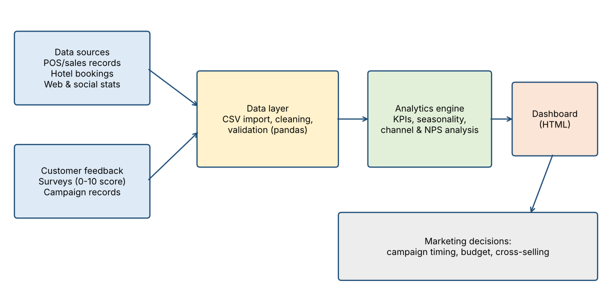

# Data Analytics Dashboard for Marketing Insights: Case Study: UI Ventures, University of Ibadan

CSC 476 semester project, Group 44, Department of Computer Science, University of Ibadan.

A small marketing analytics system for UI Ventures Limited (hotels, bakery and fast food, petrol station, printing press, consultancy and training). It reads CSV exports, computes marketing KPIs and writes a one-page dashboard.

**Important:** the CSV files in `data/` are SIMULATED sample data used to build and test the system. They are not real UI Ventures records. Replace them with real exports (same column names) to get real insights.

**Live dashboard (no install needed):** https://princejmj.github.io/Group-44-project-CSC476/

**Author:** Olubakare Oluwajomiloju (e052810), Group 44 team leader.

## Screenshots




## New in this version
Interactive date-range and division filters, animated KPI cards with month-on-month change, a 3-month trend projection, dark mode, CSV export, print/PDF, and auto-generated insights that update with the filters.

## What it shows
Revenue by division, monthly revenue and seasonality, hotel bookings by channel, website enquiry conversion by traffic source, cost per lead by campaign channel, and Net Promoter Score by division, plus auto-generated insight sentences.

## Files
| File | Purpose |
|---|---|
| `generate_data.py` | Creates the five sample CSV files in `data/` |
| `build_dashboard.py` | Computes KPIs (`kpis.json`), draws figures, writes `dashboard.html` |
| `index.html` / `dashboard.html` | The finished dashboard (open in a browser with internet access; it loads Chart.js from cdnjs) |
| `tests.py` | Eight functional tests (T1 to T6 are in the project report, Table 4.1) |

## How to run
```
pip install pandas numpy matplotlib
python generate_data.py      # or put real exports in data/
python build_dashboard.py
python tests.py
```
Then open `dashboard.html`.

## Data layouts
- `sales.csv`: month (YYYY-MM), division, revenue_ngn, transactions
- `hotel_bookings.csv`: month, channel, guest_type, nights, rate_ngn, booking_value_ngn, used_restaurant_or_other_division (0/1)
- `web_social.csv`: month, source, sessions, reservation_enquiries
- `campaigns.csv`: month, channel, spend_ngn, leads
- `feedback.csv`: division, recommend_score (0-10), main_theme
